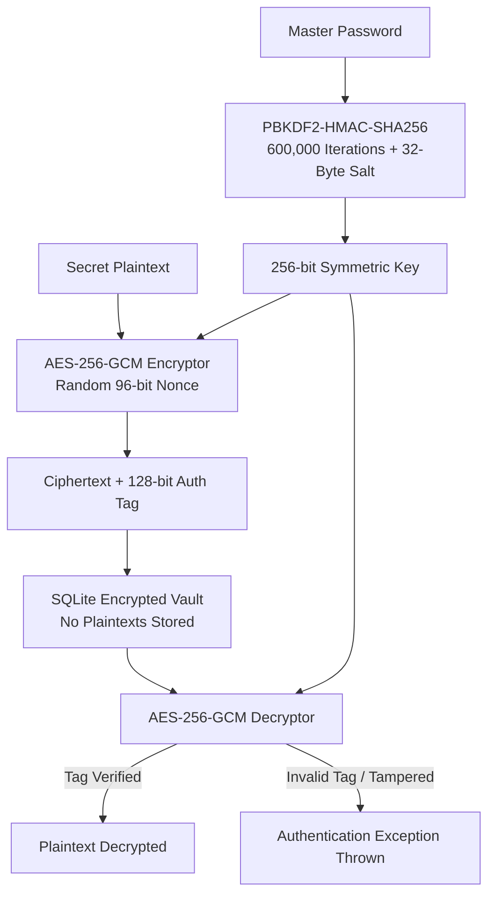

# PassVault CLI

[](https://www.python.org/downloads/)
[](https://opensource.org/licenses/MIT)
[](https://docs.pytest.org/)
[](https://github.com/piyush1008-cyber/pass-vault-cli)
[-purple.svg)](https://github.com/piyush1008-cyber/pass-vault-cli)

> **Production CLI password manager and secret vault in Python.** Built with authenticated symmetric encryption (AES-256-GCM), key stretching via PBKDF2-HMAC-SHA256 (600,000 rounds), entropy-based password auditing, and zero plaintexts at rest.

---

## Cryptographic Architecture



---

## Security Specifications

- **Authenticated Encryption:** AES-256-GCM provides both confidentiality and tamper-proof cryptographic integrity verification (detects unauthorized record modification).
- **Key Stretching:** PBKDF2-HMAC-SHA256 with 600,000 iterations (OWASP 2024+ recommendation) defends against offline dictionary and brute-force GPU attacks.
- **Unique Per-Record Nonces:** Every secret encryption generates a fresh 96-bit cryptographically secure pseudorandom nonce via `os.urandom(12)`.
- **Entropy & Health Auditing:** Evaluates password strength using Shannon bit entropy ($H = L \log_2 N$) and flags password reuse across accounts.

---

## Quickstart & CLI Commands

### 1. Run Automated Interactive Demo
```bash
python main.py demo
```

### 2. Initialize Vault Master Password
```bash
python main.py init
```

### 3. Store a Secret Credential
```bash
# Auto-generate a strong 20-character password:
python main.py add github.com --user piyush1008-cyber --generate --notes "Personal access token"

# Or provide custom password:
python main.py add aws.amazon.com --user admin --notes "Root console credentials"
```

### 4. Decrypt & Retrieve a Credential
```bash
python main.py get github.com
```

### 5. List All Stored Accounts (Metadata Only)
```bash
python main.py list
```

### 6. Security Health Audit (Flags Weak & Reused Passwords)
```bash
python main.py audit
```

### 7. Standalone Cryptographic Password Generator
```bash
python main.py generate --length 24
```

---

## Running the Test Suite

```bash
pytest -v
```

Unit and integration tests verify:
- Deterministic key derivation
- AES-256-GCM roundtrip encryption/decryption
- Tamper detection with invalid authentication tags
- Cryptographic password generation and entropy calculations
- End-to-end SQLite vault storage, deduplication, and health auditing

---

## Author & License

- **Author:** Piyush Kangle ([@piyush1008-cyber](https://github.com/piyush1008-cyber))
- **Email:** piyushkangle@gmail.com
- **License:** [MIT License](LICENSE)
